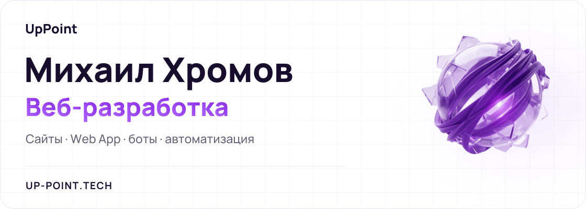
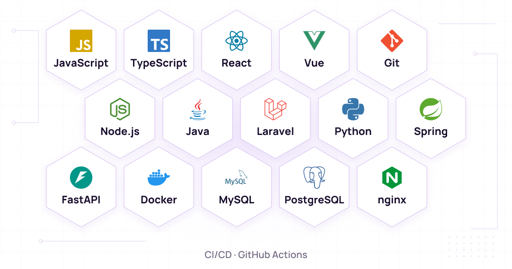

<picture>
  <source media="(max-width: 767px) and (prefers-color-scheme: dark)" srcset="assets/uppoint-header-mobile-dark.svg">
  <source media="(max-width: 767px) and (prefers-color-scheme: light)" srcset="assets/uppoint-header-mobile-light.svg">
  <source media="(prefers-color-scheme: dark)" srcset="assets/uppoint-header-dark.svg">
  <source media="(prefers-color-scheme: light)" srcset="assets/uppoint-header-light.svg">
  
</picture>

## Навыки

<picture>
  <source media="(max-width: 767px) and (prefers-color-scheme: dark)" srcset="assets/uppoint-skills-mobile-dark.svg">
  <source media="(max-width: 767px) and (prefers-color-scheme: light)" srcset="assets/uppoint-skills-mobile-light.svg">
  <source media="(prefers-color-scheme: dark)" srcset="assets/uppoint-skills-dark.svg">
  <source media="(prefers-color-scheme: light)" srcset="assets/uppoint-skills-light.svg">
  
</picture>
